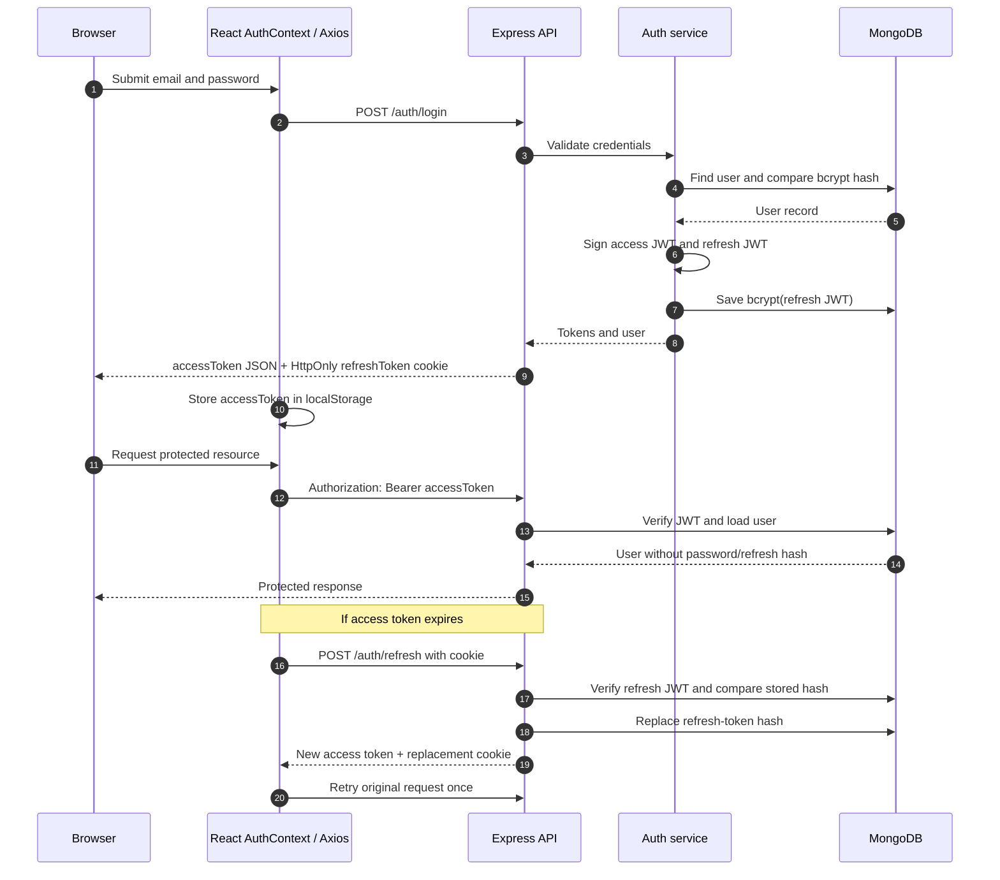

# CrowdFund — Full-Stack Crowdfunding Platform

A full-stack crowdfunding platform that enables users to discover fundraising campaigns, create campaigns, donate, and track fundraising activity. It also includes NGO workflows and a separate administration portal for managing platform activity.

**Repository:** [nitin08240/Crowdfunding-platforms](https://github.com/nitin08240/Crowdfunding-platforms)

## Features

- User registration, login, logout, email verification, and password reset.
- JWT-based user authentication with access-token refresh and refresh-token rotation.
- Separate admin login using email, password, and a secret key.
- Campaign discovery, creation, updates, and management.
- Razorpay payment order creation, signature verification, and webhook processing.
- Donation history, statistics, and receipt generation.
- NGO registration, profiles, and verification workflows.
- Admin dashboard for users, campaigns, donations, withdrawals, NGOs, settings, reports, and audit logs.
- Real-time donation updates through Socket.IO.
- Email notifications and Cloudinary image uploads.

## Technology Stack

### Frontend

| Technology | Usage |
|---|---|
| React 19 | Component-based user interface |
| TypeScript | Static typing for UI and application logic |
| Vite | Development server and production bundler |
| React Router DOM | Client-side routing and protected pages |
| Context API | User and admin authentication state |
| Axios | HTTP requests and request/response interceptors |
| TanStack Query | Server-state queries and mutations |
| React Hook Form | Form state and submission handling |
| Zod | Client-side form validation |
| Tailwind CSS | Utility-first styling |
| Radix UI | Accessible UI primitives |
| Framer Motion | UI animations and transitions |
| Recharts | Dashboard charts |
| Socket.IO Client | Real-time browser events |
| i18next / react-i18next | Internationalization |
| React Hot Toast | Toast notifications |
| Lucide React | Icons |

### Backend

| Technology | Usage |
|---|---|
| Node.js | JavaScript runtime |
| Express 4 | REST API and middleware framework |
| TypeScript | Typed backend code |
| MongoDB | Application database |
| Mongoose | MongoDB schemas, models, and queries |
| JSON Web Token (`jsonwebtoken`) | User access/refresh tokens and admin tokens |
| bcryptjs | Password, secret-key, and refresh-token hashing |
| Cookie Parser | Reading authentication cookies |
| CORS | Cross-origin browser access configuration |
| Helmet | HTTP security headers |
| express-rate-limit | API and authentication rate limits |
| express-mongo-sanitize | NoSQL query sanitization |
| xss-clean | XSS sanitization middleware |
| Zod | API request validation |
| Multer | Multipart file uploads |
| Cloudinary | Image storage |
| Razorpay | Payment order and signature integration |
| Socket.IO | Real-time donation events |
| Nodemailer | Email delivery |
| PDFKit | PDF generation |
| Pino / pino-http | Application and HTTP logging |
| dotenv | Environment configuration |

## Architecture and Project Structure

The repository contains two applications: a React frontend and an Express/TypeScript backend.

```text
Crowdfunding-platforms/
├── backend/
│   ├── src/
│   │   ├── config/        # MongoDB and environment configuration
│   │   ├── controllers/   # HTTP request handlers
│   │   ├── middleware/    # Authentication, validation, uploads, errors
│   │   ├── models/        # Mongoose schemas and models
│   │   ├── routes/        # REST API route definitions
│   │   ├── services/      # Auth, payment, email, Cloudinary services
│   │   ├── sockets/       # Socket.IO event handling
│   │   ├── utils/         # JWT helpers, logging, pagination
│   │   └── validators/    # Zod validation schemas
│   ├── scripts/           # Admin seed and maintenance scripts
│   └── package.json
└── frontend/
    ├── src/
    │   ├── components/    # Reusable UI components
    │   ├── context/       # AuthContext, AdminContext, etc.
    │   ├── pages/         # Application pages
    │   ├── services/      # Axios API client and services
    │   ├── types/         # TypeScript types
    │   └── i18n/          # Internationalization setup
    └── package.json
```

The backend mounts API routes under `/api/v1`. For example:

- `POST /api/v1/auth/login` — user login
- `POST /api/v1/admin-auth/login` — admin login
- `GET /api/v1/campaigns` — campaign listing

## Authentication and Authorization

The application has two separate authentication paths. User and admin JWTs are signed with different configured secrets and are verified by different middleware.

### 1. User registration

Relevant files:

- `frontend/src/pages/AuthPage.tsx`
- `frontend/src/context/AuthContext.tsx`
- `backend/src/routes/auth.routes.ts`
- `backend/src/controllers/auth.controller.ts`
- `backend/src/services/auth.service.ts`
- `backend/src/models/User.ts`

Registration request:

```http
POST /api/v1/auth/register
Content-Type: application/json

{
  "name": "Example User",
  "email": "user@example.com",
  "password": "your-password"
}
```

Flow:

1. The React form validates the name, email, and password using React Hook Form and Zod.
2. The backend validates the request again using `registerSchema`.
3. `authController.register` calls `authService.register`.
4. The service checks whether the email already exists and generates a random email-verification token.
5. `User` model's Mongoose pre-save hook hashes the password with bcryptjs using 12 salt rounds.
6. The auth service creates an access JWT and a refresh JWT. It stores a bcrypt hash of the refresh token in `User.refreshTokenHash`.
7. The controller sets the refresh token in an HttpOnly cookie and returns the access token and a limited user profile in the JSON response.

The registration response message asks the user to verify their email. The current registration service nevertheless issues tokens as part of registration; email verification is a separate endpoint and is not enforced by the shown `authenticate` middleware.

### 2. User login

Request:

```http
POST /api/v1/auth/login
Content-Type: application/json

{
  "email": "user@example.com",
  "password": "your-password"
}
```

Flow:

1. The frontend submits email and password to `/auth/login`.
2. The backend finds the user by email.
3. `user.comparePassword()` uses `bcrypt.compare()` to compare the submitted password against the stored password hash.
4. If credentials are valid, the service generates a new access token and refresh token.
5. The service hashes the refresh token with bcryptjs and saves that hash in MongoDB.
6. The controller sets the refresh token cookie and returns the access token and user profile.
7. `AuthContext` saves the access token in React state and in `localStorage`, and updates the current user.

### 3. User access-token verification

The Axios client in `frontend/src/services/api.ts` reads `accessToken` from `localStorage` and attaches it to user API requests:

```http
Authorization: Bearer <accessToken>
```

The backend `authenticate` middleware in `backend/src/middleware/auth.ts` then:

1. Reads the `Authorization` header.
2. Requires the `Bearer ` prefix.
3. Verifies the JWT using `JWT_ACCESS_SECRET` and the HS256 algorithm.
4. Reads the `userId` claim from the token payload.
5. Loads the user from MongoDB while excluding `passwordHash` and `refreshTokenHash` from the result.
6. Attaches the user to `req.user` and calls `next()`.

A missing, invalid, or expired token results in an authentication error. The separate `authorize(...roles)` middleware checks `req.user.role` for routes that require a specific role.

Simplified example of the current verification pattern:

```ts
const authHeader = req.headers.authorization;

if (!authHeader?.startsWith('Bearer ')) {
  throw createError('No token provided', 401);
}

const token = authHeader.split(' ')[1];
const decoded = jwt.verify(token, env.JWT_ACCESS_SECRET, {
  algorithms: ['HS256'],
}) as { userId: string };

const user = await User.findById(decoded.userId)
  .select('-passwordHash -refreshTokenHash');

if (!user) throw createError('User not found', 401);
req.user = user;
next();
```

### 4. Refresh-token rotation

The default user-token lifetimes are:

- Access token: `15m`
- Refresh token: `7d`

When a user API call gets HTTP `401`, the Axios response interceptor tries to refresh the session once:

1. It sends `POST /api/v1/auth/refresh` with credentials enabled.
2. The backend reads `refreshToken` from the cookie, with a request-body fallback.
3. The service verifies the refresh JWT using `JWT_REFRESH_SECRET`.
4. It loads the user and uses `bcrypt.compare()` to compare the presented refresh token to the stored `refreshTokenHash`.
5. If valid, it generates a new access token and a new refresh token.
6. It replaces the stored hash with a bcrypt hash of the new refresh token.
7. The controller sets the replacement refresh-token cookie and returns the new access token.
8. The frontend stores the new access token and retries the original request once.

Because the stored hash is replaced, the previous refresh token is no longer accepted by the service. This is refresh-token rotation.

### 5. User logout

The frontend calls `POST /api/v1/auth/logout`. This route requires a valid user access token through `authenticate`.

- The backend removes `refreshTokenHash` from the user's MongoDB record.
- The controller clears the `refreshToken` cookie.
- The frontend removes `accessToken` from `localStorage` and clears the in-memory user state.

Removing the stored refresh-token hash prevents that refresh token from being used to obtain new access tokens.

### 6. Admin authentication

Admin login is separate from user login. The admin page asks for three credential values:

- Email
- Password
- Secret key

Relevant files:

- `frontend/src/pages/AdminAuthPage.tsx`
- `frontend/src/context/AdminContext.tsx`
- `backend/src/routes/adminAuth.routes.ts`
- `backend/src/controllers/adminAuth.controller.ts`
- `backend/src/models/Admin.ts`
- `backend/src/utils/jwt.ts`
- `backend/src/middleware/auth.ts`

Admin login flow:

1. The frontend sends the three fields to `POST /api/v1/admin-auth/login`.
2. The backend finds a non-deleted admin by normalized email.
3. It rejects deactivated accounts.
4. It checks the password using `admin.comparePassword()` and checks the secret key using `admin.compareSecretKey()`. Both compare against bcrypt hashes.
5. Failed credential checks increment `loginAttempts`. Successful login resets the counter and updates `lastLoginAt`.
6. The backend signs a JWT containing `id`, `email`, and `role` using `JWT_ADMIN_SECRET`. Its expiry is 24 hours.
7. It creates an `ADMIN_LOGIN` audit log entry.
8. It sets an `adminToken` cookie and returns the token and admin profile in the JSON response.
9. `AdminContext.setAdminFromLogin()` stores the token and profile in local storage and updates React state before navigation to `/admin/dashboard`.

Admin token generation is implemented in `backend/src/utils/jwt.ts`:

```ts
export const generateAdminToken = (payload: AdminTokenPayload): string => {
  return jwt.sign(payload, env.JWT_ADMIN_SECRET, { expiresIn: '24h' });
};
```

The admin model hashes modified passwords and secret keys using bcryptjs. The admin controller checks those values through the model's comparison methods.

### 7. Admin request verification

The frontend Axios request interceptor detects URLs containing `/admin` and attaches `adminToken` as a Bearer token. It does not substitute the normal user's `accessToken` for an admin request.

The backend `authenticateAdmin` middleware:

1. Checks the `adminToken` cookie first.
2. If the cookie is absent, checks the `Authorization: Bearer ...` header.
3. Verifies the token using `JWT_ADMIN_SECRET` and HS256.
4. Checks the role against `admin`, `super_admin`, and `superadmin`.
5. Loads the admin record while excluding `passwordHash` and `secretKeyHash`.
6. Rejects missing, deleted, or inactive admin records.
7. Attaches the admin to `req.admin`.

The `/api/v1/admin` router applies `authenticateAdmin` with `router.use(authenticateAdmin)`, so every route in that router requires an authenticated admin.

### 8. Admin logout

`POST /api/v1/admin-auth/logout` clears the `adminToken` cookie. The controller attempts to verify an available token so it can write an `ADMIN_LOGOUT` audit log entry, but the route itself is not protected by `authenticateAdmin`. The frontend clears `adminToken`, `adminProfile`, and the `isAdmin` UI flag from local storage.

### Authentication API reference

| Method | Endpoint | Access | Purpose |
|---|---|---|---|
| POST | `/api/v1/auth/register` | Public | Create user account |
| POST | `/api/v1/auth/login` | Public | Authenticate user |
| POST | `/api/v1/auth/logout` | User access token | Revoke stored refresh session and clear cookie |
| POST | `/api/v1/auth/refresh` | Refresh cookie (or body fallback) | Rotate refresh token and issue access token |
| GET | `/api/v1/auth/me` | User access token | Return current user |
| GET | `/api/v1/auth/verify-email/:token` | Public | Verify email |
| POST | `/api/v1/auth/forgot-password` | Public | Request password-reset email |
| POST | `/api/v1/auth/reset-password` | Public | Reset password using reset token |
| POST | `/api/v1/admin-auth/login` | Public + three credentials | Admin login |
| POST | `/api/v1/admin-auth/logout` | Public route | Clear admin cookie and best-effort audit log |
| GET | `/api/v1/admin-auth/me` | Admin token | Return current admin |
| PUT | `/api/v1/admin-auth/change-password` | Admin token | Change admin password |
| PUT | `/api/v1/admin-auth/change-secret-key` | Admin token | Change admin secret key |

### User authentication request flow



### Credential and token storage summary

| Value | Backend handling | Browser handling in current code |
|---|---|---|
| User password | bcrypt hash in `User.passwordHash` | Sent in login/register request body; not intentionally persisted by AuthContext |
| User access token | JWT signed with `JWT_ACCESS_SECRET`; default 15-minute expiry | Stored in `localStorage`; sent as Bearer token |
| User refresh token | JWT signed with `JWT_REFRESH_SECRET`; bcrypt hash stored in MongoDB | HttpOnly `refreshToken` cookie; default 7-day lifetime |
| Admin password | bcrypt hash in `Admin.passwordHash` | Sent in admin login request body |
| Admin secret key | bcrypt hash in `Admin.secretKeyHash` | Sent in admin login request body |
| Admin JWT | Signed with `JWT_ADMIN_SECRET`; 24-hour expiry | HttpOnly `adminToken` cookie **and** `localStorage.adminToken`; Axios also sends Bearer token |
| Password-reset token | SHA-256 hash and one-hour expiry stored in MongoDB | Raw token is sent in the reset link and submitted with the new password |

## Security Controls

The backend configures several security-related middleware and controls:

- **Helmet:** adds common HTTP security headers.
- **CORS:** allows configured frontend origins, localhost development origins, and origins ending in `.vercel.app`; credentials are enabled.
- **General API rate limit:** 100 requests per 15 minutes under `/api`.
- **User authentication rate limit:** 10 requests per 15 minutes for user login and registration.
- **Admin login rate limit:** 10 attempts per 15 minutes.
- **NoSQL sanitization:** `express-mongo-sanitize` middleware.
- **XSS sanitization:** `xss-clean` middleware.
- **Request validation:** Zod schemas are used for authentication and other API payloads.
- **Password hashing:** bcryptjs with 12 rounds for user and admin password hashes.
- **Refresh-token storage:** the user refresh token is stored as a bcrypt hash, not as its raw token.
- **Admin audit logging:** admin login and selected credential changes are recorded.

### Production hardening considerations

These notes are based on the current implementation and are worth reviewing before production use:

1. **Tokens in localStorage:** both user access tokens and admin tokens are accessible to browser JavaScript. If an attacker achieves XSS, tokens in localStorage can be exfiltrated. Consider an architecture that keeps access tokens in memory and uses secure HttpOnly cookies, together with appropriate CSRF protection.
2. **Admin token is returned in JSON:** the admin login response includes the token in its JSON body as well as setting an HttpOnly cookie. The cookie's HttpOnly flag does not protect the token after it has been exposed to JavaScript in the response body and saved in localStorage.
3. **Admin logout is not server-side revocation:** the shown admin JWT middleware verifies the signed token and current admin record, but there is no admin token blacklist or session-revocation lookup in this flow. Clearing browser storage does not invalidate a copied JWT before its expiry. Consider a session/version mechanism if immediate revocation is required.
4. **Admin middleware token precedence:** `authenticateAdmin` prefers the cookie over the Authorization header. If the cookie is stale while the localStorage Bearer token is newer, the cookie wins. Choose one canonical transport or ensure both sources cannot become inconsistent.
5. **Cached admin profile:** `AdminContext` falls back to a cached profile if its `/admin-auth/me` request fails and a token/profile is still present. This can leave stale admin details visible in the UI; backend-protected endpoints still perform their own authentication.
6. **JWT fallback secrets:** `backend/src/config/env.ts` contains fallback signing secrets. Set strong, unique environment values and fail application startup if production secrets are missing. Never use the fallback values in production.
7. **Refresh endpoint protections:** the refresh route is covered by the general API limiter, but no dedicated refresh limiter is visible in the route configuration. Consider a specific refresh limit and suitable Origin/CSRF controls.
8. **Admin failed-login policy:** failed admin credential checks increment `loginAttempts`; the shown login handler does not itself enforce a lockout threshold. The route's rate limiter is the visible request throttle.
9. **Cookie clearing options:** verify that cookie name, path, domain, `sameSite`, and `secure` options used when clearing cookies match the options used when setting them, especially across production domains.
10. **CORS production origins:** prefer explicit production origins rather than broadly allowing every subdomain ending in `.vercel.app` when deploying a production application.

## Payments and Donations

Razorpay is used to process donations.

1. An authenticated donor calls `POST /api/v1/payments/create-order`.
2. The backend creates a Razorpay order (or a development mock order when configured for development) and a donation record with a created/pending state.
3. After checkout, the frontend submits the Razorpay order ID, payment ID, and signature to `POST /api/v1/payments/verify`.
4. The backend computes an HMAC-SHA256 signature using the Razorpay key secret and compares it with the supplied signature.
5. A MongoDB transaction updates the donation, increments campaign fundraising totals, and creates a transaction ledger record.
6. A Razorpay webhook handles `payment.captured` events as a fallback when the browser does not complete the verification request.
7. Socket.IO donation events and confirmation emails run as post-payment side effects.

The webhook route is public, but the payment service verifies the Razorpay webhook signature before processing the event. Configure a webhook secret in production.

## Environment Variables

Create `backend/.env` for backend configuration. The backend reads these values from `backend/src/config/env.ts`.

| Variable | Purpose |
|---|---|
| `NODE_ENV` | `development` or `production` |
| `PORT` | API port; defaults to `5000` |
| `MONGO_URI` | MongoDB connection string |
| `JWT_ACCESS_SECRET` | User access-token signing secret |
| `JWT_REFRESH_SECRET` | User refresh-token signing secret |
| `JWT_ADMIN_SECRET` | Admin JWT signing secret |
| `JWT_ACCESS_EXPIRES` | Access-token lifetime; defaults to `15m` |
| `JWT_REFRESH_EXPIRES` | Refresh-token lifetime; defaults to `7d` |
| `CLIENT_URL` / `FRONTEND_URL` | Allowed frontend origins |
| `RAZORPAY_KEY_ID` | Razorpay key ID |
| `RAZORPAY_KEY_SECRET` | Razorpay payment-signature secret |
| `RAZORPAY_WEBHOOK_SECRET` | Razorpay webhook-signature secret |
| `CLOUDINARY_CLOUD_NAME` | Cloudinary cloud name |
| `CLOUDINARY_API_KEY` | Cloudinary API key |
| `CLOUDINARY_API_SECRET` | Cloudinary API secret |
| `SMTP_HOST` | SMTP server host |
| `SMTP_PORT` | SMTP server port |
| `SMTP_USER` | SMTP username |
| `SMTP_PASS` | SMTP password or app password |
| `SMTP_FROM` | Email sender identity |
| `REDIS_URL` | Redis URL exposed in configuration; confirm runtime integration before relying on it |
| `SENTRY_DSN` | Sentry DSN exposed in configuration; confirm runtime integration before relying on it |

Example backend development configuration:

```env
NODE_ENV=development
PORT=5000
MONGO_URI=mongodb://127.0.0.1:27017/crowdfunding
JWT_ACCESS_SECRET=replace_with_a_long_random_secret
JWT_REFRESH_SECRET=replace_with_a_different_long_random_secret
JWT_ADMIN_SECRET=replace_with_another_long_random_secret
JWT_ACCESS_EXPIRES=15m
JWT_REFRESH_EXPIRES=7d
CLIENT_URL=http://localhost:5173
FRONTEND_URL=http://localhost:5173
```

Create `frontend/.env` for the frontend API URL:

```env
VITE_API_URL=http://localhost:5000/api/v1
```

The repository's production frontend environment currently points to a Render-hosted API. Replace that URL with your own backend deployment URL when deploying a fork.

**Never commit actual passwords, JWT signing secrets, database credentials, Razorpay secrets, Cloudinary secrets, or SMTP passwords.** Only expose variables prefixed with `VITE_` when they are safe to be included in the browser bundle. Backend secrets must remain on the server.

## Run Locally

### Prerequisites

- Node.js and npm
- MongoDB (local or hosted)
- Razorpay, Cloudinary, and SMTP credentials for the related integrations

### 1. Clone the repository

```bash
git clone https://github.com/nitin08240/Crowdfunding-platforms.git
cd Crowdfunding-platforms
```

### 2. Install and start the backend

```bash
cd backend
npm install
```

Create `backend/.env` using the example above, then start the development server:

```bash
npm run dev
```

The backend's development script runs `src/server.ts` through `ts-node-dev`. The server connects to MongoDB before it starts listening.

### 3. Install and start the frontend

In a second terminal:

```bash
cd frontend
npm install
```

Create `frontend/.env` with:

```env
VITE_API_URL=http://localhost:5000/api/v1
```

Then run:

```bash
npm run dev
```

Open the local URL printed by Vite (typically `http://localhost:5173`).

### 4. Build for production

Backend:

```bash
cd backend
npm run build
npm start
```

Frontend:

```bash
cd frontend
npm run build
npm run preview
```

## Useful Scripts

### Backend (`backend/package.json`)

| Command | Description |
|---|---|
| `npm run dev` | Run the TypeScript backend in development with restart |
| `npm run build` | Compile TypeScript into `dist/` |
| `npm start` | Build first, then start the compiled server |
| `npm run lint` | Lint backend TypeScript files |
| `npm run seed:admin` | Run the admin seed script |

### Frontend (`frontend/package.json`)

| Command | Description |
|---|---|
| `npm run dev` | Start the Vite development server |
| `npm run build` | Type-check and build the frontend |
| `npm run preview` | Preview the production build locally |
| `npm run lint` | Run ESLint |

## Main API Groups

| Prefix | Responsibility |
|---|---|
| `/api/v1/auth` | User registration, login, profile, email verification, password reset |
| `/api/v1/admin-auth` | Admin login, logout, profile, credential changes |
| `/api/v1/admin` | Protected admin dashboard and platform operations |
| `/api/v1/campaigns` | Campaign discovery and management |
| `/api/v1/donations` | Donation history, statistics, and receipts |
| `/api/v1/payments` | Razorpay order creation, verification, and webhook |
| `/api/v1/withdrawals` | Withdrawal workflows |
| `/api/v1/analytics` | Analytics endpoints |
| `/api/v1/ngos` | NGO-related workflows |
| `/api/v1/notifications` | Notifications |

## Deployment

The frontend contains Vercel configuration in `frontend/vercel.json` and uses `VITE_API_URL` to select the backend API. The checked-in production frontend environment currently points to a Render-hosted backend.

For production deployment:

- Configure all backend secrets as environment variables in the backend hosting provider.
- Set `VITE_API_URL` to the deployed backend API base URL and rebuild the frontend.
- Configure the backend CORS allow-list for the exact frontend origin.
- Use HTTPS for the frontend and API.
- Verify that cross-site cookies use the appropriate `SameSite` and `Secure` attributes for the deployment topology.
- Test login, refresh, logout, admin authentication, and payment webhooks against the deployed services.

## License

Add the license and attribution information that applies to this project before redistribution.
